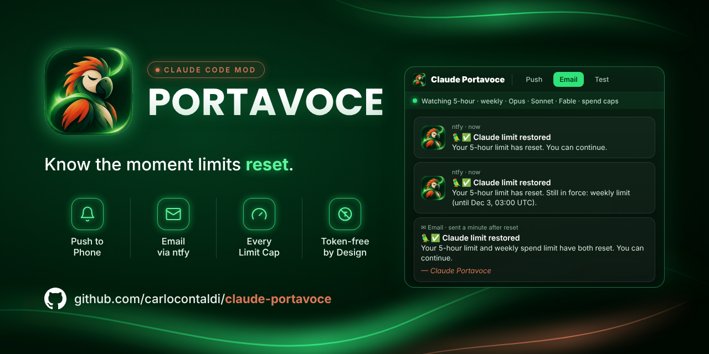

<h1 align="center">
  <br>
  Claude Portavoce
</h1>

> **por·ta·vo·ce** · Italian /portaˈvotʃe/ (*por-ta-VOH-cheh*) · *noun*, masculine and feminine, plural unchanged
>
> 1. One who speaks on behalf of another person or a group; a spokesperson.
> 2. A megaphone; on ships, a speaking tube that carries the voice from one room to the next.
>
> *From* portare, *to carry, and* voce, *voice.*

<br>

Claude Code stops when a 5-hour, weekly, per-model (Opus, Sonnet, Fable) or spend limit is hit. Claude Portavoce speaks for it while it can't: it watches the clock for you and sends a push, and an email through ntfy, a minute after each cap resets (by default), with no terminal or Claude session left open. The message says which caps came back, and whether another one still holds.

<p1 align="center">
  <br>
</p1>

**Token-free.** It makes no model calls: the waiting is done by a plain Python process, and the hook fires after Claude has already stopped and prints nothing, so it adds nothing to the conversation and costs none of your usage. The `/portavoce` commands run a local script and make no model call either.

How it works: the plugin's `classic.StopFailure` module hook (it acts on the `rate_limit` error) hands the event to a detached watcher and returns at once. The watcher reads the caps from the limit error at the end of the transcript (its `rate_limit_info`, else the `resets ... (zone)` time in the message), sleeps until reset + 60 s (or the post-reset delay), then POSTs to `ntfy.sh/<topic>`. When the error also reports a spend cap (Claude Code's "individual" or "monthly spend limit"), a cap that resets later gets its own push when it does, and caps resetting within two minutes of each other share one. The error does not say whether a spend cap is daily, weekly or monthly, so Portavoce infers it from the reset time (more than a week away, at the turn of a month or at a day and time already seen for a monthly cap: monthly; one to seven days: weekly; the error's own daily flag: daily) and keeps "individual spend limit" when it cannot tell. One watcher runs per reset time. A limit message with no reset time is only logged. A window cap is waited for up to 8 days, a spend cap up to 35. The watcher is an ordinary background process: it outlives the terminal and the Claude session, but not a reboot or shutdown, and a push that falls due while the machine is off is never sent.

What leaves your machine: one HTTPS request to ntfy.sh (or to the server in `PORTAVOCE_NTFY_URL`). The topic is in the URL; your email address and token are in headers, next to a fixed title that starts with a parrot and a check mark emoji (none with *Show the parrot emoji* off; sent as an RFC 2047 encoded word, which ntfy decodes) and the address of the logo on raw.githubusercontent.com (the `Icon` header; the ntfy app on your phone downloads the image, this machine does not); the body is one or two lines such as "Your 5-hour limit has reset. You can continue.", "Your 5-hour limit and weekly spend limit have both reset. You can continue." or "Your 5-hour limit has reset. You can continue. Usage credits stay capped by your weekly spend limit until Nov 17, 00:00 UTC." (a spend cap limits only the usage credits, so the plan is usable again) or "Your 5-hour limit has reset. Still in force: weekly limit (until Dec 3, 03:00 UTC)." An email also ends with the signature `— Claude Portavoce`; a push to the phone alone does not. Nothing else is sent.

## Requirements

- Linux, macOS, or Windows (uses `fcntl.flock` on POSIX and `msvcrt.locking` on Windows; CI gates on Linux only, its Windows leg is informational) and Python 3.9 or newer, standard library only. The StopFailure hook is part of the plugin's module, so it runs no shell command and needs no particular shell; it and the slash commands run `python3`, or `python` when there is no working `python3`. Python on Windows has no time zone database: there, `pip install tzdata`; without it a reset stated in a named zone is not understood.
- An [ntfy.sh](https://ntfy.sh) account and access token. ntfy.sh refuses emails from anonymous requests (HTTP 400, code 40053 when last tried, 2026-10-20), and the free tier allowed 5 emails a day.

## Install

At the prompt of a terminal session:

```
/plugin install portavoce --marketplace carlocontaldi/claude-portavoce
```

From a shell:

```
claude plugin install portavoce --marketplace carlocontaldi/claude-portavoce
```

If `~/.claude/settings.json` already registers `limit_restore_notify.py` under `hooks.StopFailure`, remove that entry so the hook is not registered twice.

## Configure

Claude Code asks for the notification email and the access token when you enable the plugin and hands them to the hook as environment variables. The token is kept in Claude Code's secure storage: the macOS Keychain, or a Secret Service keyring on Linux when one is available. Without one, typical on a headless server, it falls back to `~/.claude/.credentials.json`, a plaintext file readable only by you (behaviour of Claude Code 2.1.319).

| Value | Required | Meaning |
|---|---|---|
| ntfy topic | No | Empty: a private topic Portavoce makes, `claude-portavoce-<random>` (see below). Set a name to use your own. |
| Notification email | No | Where ntfy sends the email. Empty: no email, the push goes to the phone only. |
| ntfy access token | No | Your ntfy access token. ntfy.sh refuses an email without it, so Portavoce sends the email only when this and the notification email are both set. |
| Show the parrot emoji | No | On by default. The push and email titles start with 🦜✅; off gives plain titles. |
| Post-reset delay | No | Seconds to wait after a reset before the push, 0 to 86400. Empty or anything else (logged): 60. Another value moves the push away from Goon's resume time, so the shared email (see below) applies only while the two are within five seconds. |

The email and the token are both optional. With either one missing, Portavoce pushes to the phone only, so subscribe the phone as in step 2 below.

Change a value later from a shell; options you leave out keep their values:

```
claude plugin configure portavoce@claude-portavoce          # shows which are set
echo '{"ntfy_topic": "my-own-topic"}' | claude plugin configure portavoce@claude-portavoce --values-stdin
echo '{"ntfy_topic": ""}' | claude plugin configure portavoce@claude-portavoce --values-stdin    # back to the private topic
```

Versions before 0.2.0 read these values from files in `~/.claude/limit-watch/`, the folder this plugin used before it was renamed Portavoce; those files and that folder are no longer used, and you can delete them.

## Set up ntfy

1. **Email and token (optional, for the email).** ntfy.sh refuses emails from anonymous requests, so [sign up](https://ntfy.sh/app) (free), open Account, create an access token and enter it as the access token above. The free tier allows 5 emails a day, shared with [Claude Goon](https://github.com/carlocontaldi/claude-goon) if you use its email option. The email arrives whether or not a phone is subscribed.
2. **Phone (optional).** In a Claude Code session run `/portavoce topic`. The first time, Portavoce makes a private topic, `claude-portavoce-` and 22 random letters and digits, keeps it in `~/.claude/portavoce/topic` (readable only by you) and shows it. Install the ntfy app (Android: Google Play or F-Droid; iOS: App Store), tap **+**, enter that topic and keep the default server, `ntfy.sh`. On Android, opening `ntfy://ntfy.sh/<topic>` subscribes in one step.
3. **Try it.** `/portavoce test` sends one push to the topic, without an email, and says whether it went through.

`/portavoce topic new` makes another topic if the first one leaks (subscribe to it and drop the old one). The commands run a local script and make no model call. The email's sender reads `ntfy.sh/<topic>`; that comes from ntfy and the topic name.

A topic on the public server is readable and writable by anyone who knows its name, which is why the name is random and not a fixed one such as `claude-portavoce`. ntfy.sh [offers reserved topics with access control on paid plans](https://docs.ntfy.sh/terms/).

## With Goon

When [Claude Goon](https://github.com/carlocontaldi/claude-goon) is installed too, the two send one email instead of two, so the free tier's five emails a day last longer. It applies when Goon will email the same address as Portavoce and its resume time is within five seconds of Portavoce's push time (both are set a minute after the reset unless you change the post-reset delay). Goon puts Portavoce's announcement at the start of its own email (`Your 5-hour limit has reset. You can continue. Goon: resumed 2 closed sessions.`). Portavoce still pushes to its own topic, without the email, as soon as Goon has claimed the email.

Portavoce sends its own email in every other case: no Goon, a Goon without an email set or with another address, quiet hours that move Goon's resume, a Goon that is off or has nothing to report (every session had already continued), a Goon whose push failed, and a cap that resets later than the one Goon waits for. When Goon claimed the email but sent nothing, your phone gets a second push from Portavoce, the one with the email. If Goon has not claimed the email within 10 minutes, Portavoce sends its own and Goon then pushes without one. If the shared folder `~/.claude/meridiana/` cannot be used, each plugin sends its own email. Portavoce's own email applies only when both the email and the token are set; otherwise its fallback is a push to the phone alone.

A decision file settles who emails, so the two never both send the email for one reset; the exceptions are listed in the [Meridiana README](https://github.com/carlocontaldi/claude-meridiana#one-email-for-both-plugins). The files hold only which caps reset and when, and stay on this machine. The log says `left the announcement with Goon` when it hands over.

## Check it

`~/.claude/portavoce/log.txt` records each cap seen (`5-hour limit and weekly spend limit; will push at ...`), each push (`pushed (attempt 1)`), and failures. The folder is `~/.claude/portavoce/`; set `PORTAVOCE_DIR` to use another. To test against a local server, set `PORTAVOCE_NTFY_URL`.

The zone in the limit message is the IANA zone of the machine running Claude Code, so each machine needs its own copy of the hook and config. A hook only fires for sessions on the machine where it is installed.

## Test

`hooks/limitwatch.py` is a copy of [claude-meridiana](https://github.com/carlocontaldi/claude-meridiana), shared with Claude Goon; change it there and run its `sync.py`, not here. A test fails if the copy no longer matches its header.

```
python3 -m unittest discover -s tests
claude plugin test .
```

## License

[MIT](LICENSE)
